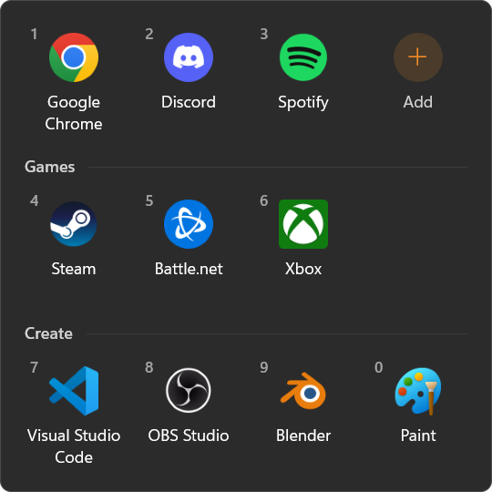
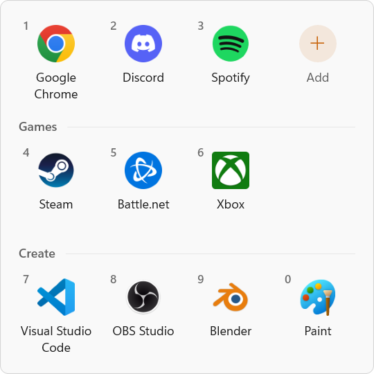
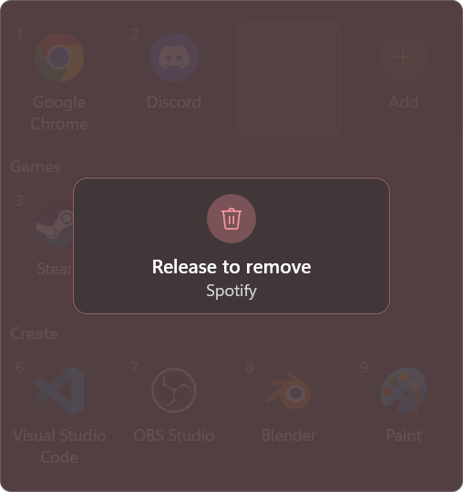
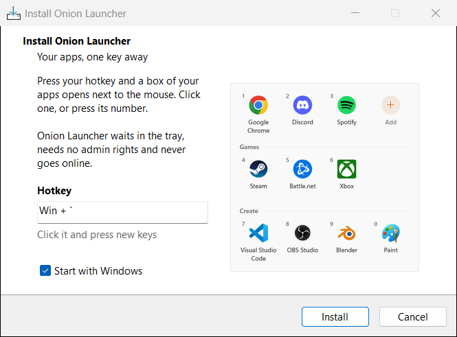
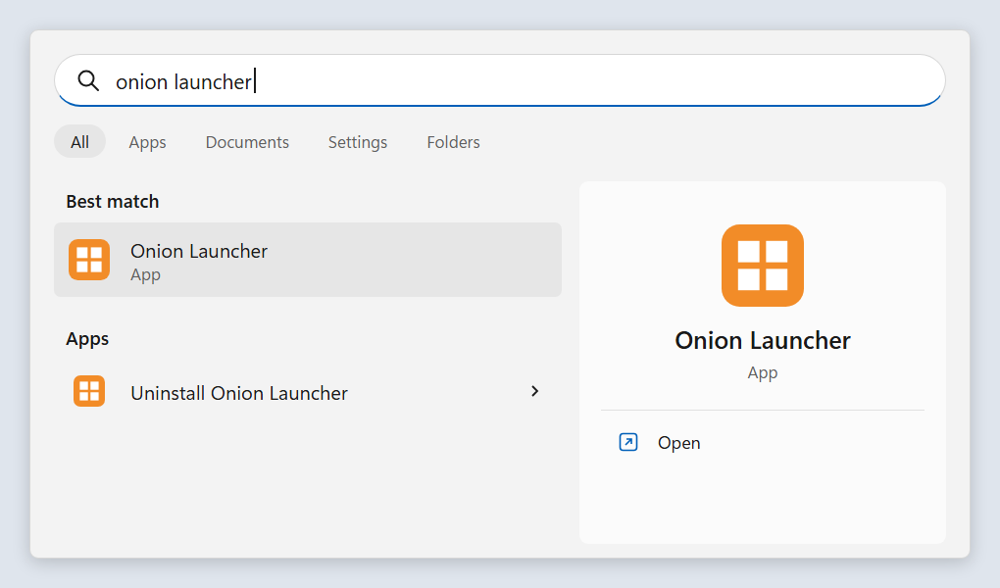

# Onion Launcher

Your apps, one key away. Press **Win + `** and a small box of your favourite apps pops up
next to the mouse. Click one, or press its number, and it opens.

<p align="center">
  
  
</p>

Free and open source, for Windows 11. Small (a 1 MB app, no admin rights), and it never goes online.

<!-- release -->
Version **0.2.9** · [VirusTotal: 71 of 71 clean](https://www.virustotal.com/gui/file/0446f3c30a3f3d30016cbfd3544b451d4ec21d1cb1d5fc7bc5d7d1917a3e368d) · [what's new](CHANGELOG.md)
<!-- /release -->

## Using it

- **Open the box:** press **Win + `** (the key left of 1, whatever it shows on your
  keyboard), or click its icon in the tray.
  Press **Esc** or click anywhere else to close it.
- **Change the hotkey:** right-click the tray icon, pick **Change hotkey...**, and press the
  new keys (with Ctrl, Alt or Win, like **Ctrl + Space**). **Esc** keeps the old one.
- **Open an app:** click it, or press its number (**1** to **9**, then **0**).
- **Add apps:** click the **+** tile (or press **+**) to search every app on the PC, then click
  one or press **Enter**. **Browse files** at the bottom picks any program or shortcut.
  You can also drop files straight onto the box.
- **Move apps around:** drag a tile to a new spot.
- **Categories:** right-click an app, **Move to category > New category...**, and give it a
  name. Drag apps in and out of a category. Right-click a heading to rename or delete it
  (its apps go back to the top).
- **Remove an app:** right-click it and pick **Remove from Onion Launcher**, or drag it
  out of the box and hold it there for 2 seconds until it says **Release to remove**.
  Let go sooner and nothing happens.

<p align="center">
  
</p>

It follows Windows' light or dark mode by itself. If another app already uses the hotkey,
Onion Launcher says so when it starts, and the tray icon still works.

## Install



Download `OnionLauncherSetup.exe` from the [latest release](../../releases/latest) and run
it. It asks whether Onion Launcher should start with Windows; press **Install**. No admin
rights needed: it goes in `%LOCALAPPDATA%\Programs\Onion Launcher`, the Start menu and
Settings > Apps.

The installer isn't code-signed yet, so Windows may show a "Windows protected your PC"
warning the first time: click **More info**, then **Run anyway**. Every release is scanned
on VirusTotal (the link is at the top) and lists the installer's SHA-256, so you can check
the download with `Get-FileHash OnionLauncherSetup.exe`.

Onion Launcher opens as soon as it's installed. If you untick **Start with Windows**, start
it yourself after a restart: search the Start menu for **Onion Launcher**. **Uninstall Onion Launcher** is right there too (or use Settings > Apps >
Installed apps).

<picture>
  <source media="(prefers-color-scheme: dark)" srcset="docs/images/start-menu-dark.png">
  
</picture>

Running a newer `OnionLauncherSetup.exe` updates it, and your list of apps stays.

## Your data

Your list of apps is saved in `%APPDATA%\OnionLauncher\apps.json`, and that's all it
stores. If that file ever gets damaged (say, by a typo while editing it by hand), it's kept
as `apps.broken.json` next to it and Onion Launcher starts with an empty list; it tells you
once. Onion Launcher has no account, no updates check and no usage counting: it never
connects to the internet.

**To uninstall:** search the Start menu for **Uninstall Onion Launcher**, or use Settings >
Apps > Installed apps. Your list stays in `%APPDATA%\OnionLauncher` in case you install it
again; delete that folder too to remove every trace.

## Build it yourself

You need [Rust](https://rustup.rs) (stable).

```
cargo build --release
```

The exe lands in `target\release\OnionLauncher.exe` and runs from anywhere. To make the
installer, use `powershell -File scripts\build-release.ps1` (needs
[Inno Setup](https://jrsoftware.org/isinfo.php) 6.7 or newer and Python with Pillow): it
builds the same exe but leaves your own folder names out of it, checks that they're gone,
and wraps it in `target\installer\OnionLauncherSetup.exe` (from `installer\OnionLauncher.iss`).
`powershell -File scripts\installer_pictures.ps1` then takes pictures of the installer's
pages on a hidden desktop, without installing anything.
`python scripts\vt_scan.py target\installer\OnionLauncherSetup.exe` scans the installer on
VirusTotal (it needs a free API key; the script says where to put it).

### The self-test

The app can drive itself (opening the box, hovering, clicking, typing, dragging) and save a
picture of every step. It runs on a hidden desktop, so nothing appears on your screen:

```
copy tests\fixtures\cats.json %TEMP%\cats.json
powershell -File tools\run_hidden.ps1 -CommandLine "target\release\OnionLauncher.exe --selftest %TEMP% --tag cats --theme dark --config %TEMP%\cats.json"
```

Tags: `full`, `dark`, `empty`, `big`, `cats` (categories and dragging), `hotkey` (the Change hotkey screen), `frame` and `readme`
(the pictures on this page). `--config` points it at a test copy of the app list, so your
real list is never touched; the test may change that copy, so always use a copy.
Made-up lists live in `tests/fixtures/`: `full.json` and `cats.json` use only apps that
come with Windows, `empty.json` is empty, and `readme.json` is the list behind the pictures
(apps that aren't installed show a blank tile).

## Licence

[GPL-3.0](LICENSE). App names and icons in the pictures belong to their owners.
